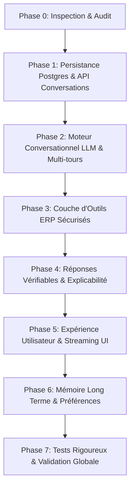

# Audit Technique et État des Lieux — AI-NÉGOCE Copilot

**Date :** 21 Octobre 2026  
**Auteurs :** Équipe Architecture & Ingénierie IA  
**Statut :** Phase 0 — Inspection terminée, prêt pour Phase 1  
**Référence :** CODEX AI-NÉGOCE COPILOT 2.0

---

## 1. Synthèse Exécutive

L'audit approfondi de la base de code existante (React 19 + TypeScript + Express 5 + SQLite + PostgreSQL) révèle que le module actuel « AI Copilot » est un **prototype déterministe basé sur des expressions régulières**, sans modèle de langage (LLM) sous-jacent, sans persistance réelle des conversations côté interface utilisateur, et sans support pour les langues cibles (arabe tunisien et arabe standard).

Bien que l'architecture de sécurité (isolation multi-tenant PostgreSQL avec Row-Level Security, vérification OIDC, RBAC et périmètres d'agences) soit robuste et couverte par 463 tests unitaires/d'intégration automatisés, l'expérience utilisateur du Copilot reste figée :
- **L'historique des conversations est factice** dans l'interface (liste statique codée en dur dans React).
- **Le dialogue multi-tours est inexistant** dans l'UI (seule la dernière question/réponse est affichée ; tout s'efface au rechargement de la page).
- **Le moteur de réponse est un routeur regex** (`server/services.ts`) qui rejette toute question formulée en langage naturel riche, en arabe ou en dialecte tunisien, ainsi que toute question touchant aux fournisseurs, tendances temporelles ou explications causales de marge.
- **Les données ERP interrogées sont restreintes** à un sous-ensemble partiel en mémoire (`sales`, `receivables`, `inventory`), ignorant les tables d'achats, commandes, factures fournisseurs et mouvements de stocks pourtant disponibles dans le bac à sable SQLite.

Le tableau ci-dessous résume le statut réel de chaque composant du Copilot.

---

## 2. Matrice d'Audit des Fonctionnalités Copilot

| Fonctionnalité | Statut Réel | Implémentation Actuelle | Lacunes & Défauts Identifiés |
|---|---|---|---|
| **Composant UI Chat** | PARTIELLEMENT RÉEL | `CopilotModule` (`src/App.tsx:1510-1643`) | Affiche uniquement la dernière question/réponse. Ne supporte pas le streaming ni le Markdown. |
| **Historique / Sidebar** | FACTICE (MOCKÉ) | `src/App.tsx:1545-1562` | 4 conversations codées en dur ("Analyse marge février", etc.). Clics inactifs. |
| **Multi-tours UI** | CASSÉ / ABSENT | `src/App.tsx:1513, 1599` | `messages: string[]` ne stocke que les questions ; `ChatAnswer` n'affiche que le dernier élément. Historique perdu à chaque nouveau tour ou refresh. |
| **Persistance DB Conversations** | RÉEL BACKEND / ABSENT FRONTEND | `server/store.ts` (PostgreSQL + MemoryStore), `migrations/001_initial.sql`, `002_tenancy.sql` | Tables `conversations` et `messages` avec RLS fonctionnelles côté serveur, mais `src/api.ts` n'appelle jamais ces routes. Aucune API de listage (`GET /conversations`), suppression (`DELETE`) ou renommage (`PATCH`). |
| **Fournisseur IA (LLM)** | ABSENT / BLOQUÉ | Aucun adaptateur LLM | Documenté explicitement dans `copilot-benchmark.test.ts:2-3` : *"No LLM provider exists in this codebase"*. `groundedAnswer` est un routeur regex déterministe. |
| **Compréhension Linguistique (FR / TN / AR)** | INCOMPLET (FR seul) | Regex ASCII normalisées (`server/services.ts:147`) | Ne gère que des mots-clés français stricts. Rejette l'arabe et le dialecte tunisien (ex: *"9addech el CA mta3 Sfax ?"* ou *"كم بلغت الأرباح ؟"* renvoient une erreur 400 ou un rejet *"question non reconnue"*). |
| **Outils & Requêtes Métier ERP** | INCOMPLET | `server/services.ts` (agrégations en mémoire) | Outils limités à `kpi_overview`, `low_stock`, `inventory_value`, `receivables`, `agency_comparison`, `top_customers`. Achats, fournisseurs et délais de paiement bloqués par regex `OUT_OF_DOMAIN`. |
| **Modèle de Données ERP (SQLite)** | RÉEL | SQLite (`var/ai-negoce.db`, 15 tables) | Base très complète (achats, ventes, règlements, stocks, fournisseurs), mais le Copilot n'en lit qu'une infime partie via `datasetFrom`. |
| **Génération Streaming** | ABSENT | Réponse JSON synchrone bloquante | Aucun endpoint SSE (`text/event-stream`) ni gestion de streaming côté client. Spinner CSS statique d'attente. |
| **Explication Causale & Calculs** | ABSENT | Réponses textuelles formatées en dur | Impossible d'expliquer *pourquoi* la marge a chuté, ni de décomposer les facteurs de coût ou de remise. |
| **Contrôle d'Accès & Tenancy** | RÉEL & AUDITÉ | JWT Bearer, RLS Postgres, `scopedAgencies` | Très solide côté backend : 0 fuite inter-agences ni inter-tenants sur 108 tests du benchmark et 28 tests de tenancy. |
| **Mémoire Utilisateur (Long Terme)** | ABSENT | Non implémenté | Aucune table de préférences ou de mémoire contextuelle persistante. |

---

## 3. Inspection Détaillée par Sous-Système

### 3.1. Composants Front-End (`src/App.tsx`, `src/api.ts`)

1. **Interface de discussion (`CopilotModule`, `ChatAnswer`, `CopilotEmpty`) :**
   - Située dans `src/App.tsx` (lignes 1510 à 1820).
   - `CopilotModule` possède un état local rudimentaire :
     ```tsx
     const [messages, setMessages] = useState<string[]>([])
     const [answer, setAnswer] = useState<any>(null)
     ```
   - L'envoi via `ask()` se contente d'ajouter la question courante à `messages` et d'appeler `api.ask(normalizedQuestion)`.
   - `ChatAnswer` ne reçoit que `question={messages[messages.length - 1]}` et `answer={answer}`. Toutes les interactions précédentes disparaissent visuellement dès qu'une nouvelle question est posée.
   - Les initiales de l'avatar utilisateur sont codées en dur : `<div className="avatar small">SB</div>`, sans lien avec la session réelle (ex: Administrateur "AD").
   - La zone de rendu n'analyse pas le Markdown : les retours textuels sont injectés directement dans une balise `<p>`. Les listes, le gras, les tableaux markdown et les explications structurées ne peuvent pas s'afficher proprement.

2. **Sidebar d'historique :**
   - Les entrées d'historique ("Analyse marge février", "Créances clients à risque", "État du stock dormant", "Top fournisseurs 2025") sont codées en dur sous des en-têtes fixes ("Aujourd'hui", "Cette semaine").
   - Le bouton `Nouvelle conversation` ne fait que vider les états React locaux ; il ne crée pas d'enregistrement en base et ne permet pas de retrouver les conversations passées.

3. **Client API (`src/api.ts`) :**
   - Méthode existante :
     ```ts
     ask: (question: string) =>
       request<any>("/copilot/query", {
         method: "POST",
         headers: { "Content-Type": "application/json" },
         body: JSON.stringify({ question }),
       })
     ```
   - Le paramètre `conversationId` n'est jamais transmis par le client.
   - Aucune méthode n'existe pour `listConversations()`, `getConversation(id)`, `deleteConversation(id)` ou `renameConversation(id)`.

---

### 3.2. API Backend & Moteur IA Actuel (`server/app.ts`, `server/services.ts`)

1. **Routes existantes dans `server/app.ts` :**
   - `POST /api/v1/conversations` (lignes 514-535) : Valide `{ title }` avec Zod, appelle `tenant(req).createConversation(req.principal.id, title)`, émet un log d'audit `conversation.created` et renvoie la conversation (statut 201).
   - `GET /api/v1/conversations/:id` (lignes 537-549) : Récupère la conversation et ses messages si `ownerId === req.principal.id`. Renvoie 404 sinon.
   - `POST /api/v1/copilot/query` (lignes 550-627) : Valide `{ question, conversationId?, filters?: { agency?, from?, to? } }`. Applique le périmètre d'agence (`scopedAgencies`), charge la conversation si `conversationId` est fourni, puis appelle `groundedAnswer()`. Si une conversation existe, insère le message utilisateur et le message assistant.
   
2. **Manques critiques dans les routes Express :**
   - **Absence de `GET /api/v1/conversations` :** Il est actuellement impossible pour le client de lister ses conversations existantes !
   - **Absence de `PATCH /api/v1/conversations/:id` :** Impossible de renommer une conversation.
   - **Absence de `DELETE /api/v1/conversations/:id` :** Impossible de supprimer une conversation.
   - **Absence de pagination sur les messages :** `GET /api/v1/conversations/:id` renvoie l'intégralité des messages sans curseur ni limite.
   - **Absence de streaming :** Aucune route compatible Server-Sent Events (SSE).

3. **Moteur `groundedAnswer` dans `server/services.ts` :**
   - Architecture 100% regex (lignes 146-362).
   - Expressions régulières de blocage :
     - `OUT_OF_DOMAIN = /\b(fournisseurs?|budgets?|previsionnel|previsions?|taux de change|objectifs?|meteo)\b/`
     - `TREND = /\b(tendances?|evolutions?|mois par mois)\b/`
     - `NATURAL_PERIOD = /\b(19|20)\d{2}\b|\b(janvier|fevrier|...)\b/`
     - `AGING = /\b(plus de \d+ jours|anciennete|balance agee|vieillissement)\b/`
     - `PAYMENT_DELAY = /\b(delais? (?:moyens? )?(?:de )?paiement|paiement moyen)\b/`
   - Par conséquent, des questions élémentaires de gestion comme *"Pourquoi notre marge a baissé en février ?"*, *"Et pour janvier ?"*, ou *"Quels fournisseurs ont contribué à cette baisse ?"* sont **systématiquement rejetées avec le statut `unsupported`**.
   - Le support du suivi conversationnel (`context.previousQuestion`) se résume à 12 lignes (277-290) vérifiant si la requête commence par "et" ou "compare avec".

---

### 3.3. Schéma PostgreSQL & Isolation des Tenants

1. **Tables de persistance (`migrations/001_initial.sql` et `002_tenancy.sql`) :**
   - `conversations` :
     ```sql
     id uuid PRIMARY KEY DEFAULT gen_random_uuid(),
     organization_id text NOT NULL REFERENCES organizations(id),
     owner_id text NOT NULL,
     title text NOT NULL,
     created_at timestamptz NOT NULL DEFAULT now()
     ```
   - `messages` :
     ```sql
     id uuid PRIMARY KEY DEFAULT gen_random_uuid(),
     organization_id text NOT NULL,
     conversation_id uuid NOT NULL,
     role text NOT NULL CHECK(role IN ('user','assistant')),
     content text NOT NULL,
     sources jsonb NOT NULL DEFAULT '[]',
     created_at timestamptz NOT NULL DEFAULT now(),
     CONSTRAINT fk_messages_conversation FOREIGN KEY (organization_id, conversation_id)
       REFERENCES conversations (organization_id, id) ON DELETE CASCADE
     ```
   - `audit_logs` :
     ```sql
     id bigserial PRIMARY KEY,
     organization_id text NOT NULL,
     actor_id text NOT NULL,
     action text NOT NULL,
     resource_type text NOT NULL,
     resource_id text NOT NULL,
     metadata jsonb NOT NULL DEFAULT '{}',
     created_at timestamptz NOT NULL DEFAULT now()
     ```

2. **Sécurité Row-Level Security (RLS) :**
   - La politique RLS `tenant_isolation` est activée et forcée sur `conversations`, `messages` et `audit_logs`.
   - `PostgresStore` exécute chaque requête dans `tenantTx` sous le rôle restreint `ai_negoce_app` avec la variable de session `app.organization_id`.
   - L'isolation des locataires est totalement étanche et vérifiée par tests.

3. **Évolutions nécessaires du schéma (Phase 1 & Phase 6) :**
   - Ajouter un index sur `conversations(organization_id, owner_id, updated_at DESC)` pour accélérer l'affichage de la barre latérale.
   - Ajouter une colonne `updated_at` sur `conversations` pour trier par activité récente.
   - Prévoir une table `user_memory_preferences` pour le stockage des préférences explicitement consenties (Phase 6).

---

### 3.4. Structure de la Base SQLite Demo ERP (`var/ai-negoce.db`)

La base SQLite contient 15 tables relationnelles générées à partir du jeu de données synthétique (`migrations/sqlite/001_erp.sql`) :
1. `agencies` : 5 agences tunisiennes (Tunis Centre, Sfax, Sousse, Bizerte, Nabeul).
2. `customers` : Clients avec agence, commercial, limite de crédit, conditions de règlement.
3. `suppliers` : Fournisseurs avec matricule fiscal, ville, délais de paiement.
4. `product_categories` : Familles de produits avec taux de TVA par défaut.
5. `products` : Articles avec SKU, libellé, prix de revient unitaire (`unit_cost`), prix catalogue, seuil de réapprovisionnement.
6. `sales_invoices` : Factures et avoirs clients avec montants HT, TVA, timbre, TTC et coût de revient total (`total_cost`).
7. `sales_invoice_lines` : Lignes d'articles avec remises, prix unitaires, TVA et coût de revient ligne.
8. `purchase_orders` & `purchase_order_lines` : Bons de commande fournisseurs.
9. `supplier_invoices` & `supplier_invoice_lines` : Factures d'achats fournisseurs.
10. `receivables` : Créances clients ouvertes, échéance, retards (`days_overdue`).
11. `payments` : Règlements clients encaissés.
12. `stock_movements` : Mouvements entrées/sorties avec motif et référence.
13. `inventory` : Stock physique actuel, coût unitaire, seuil de réapprovisionnement.
14. `representatives` : Commerciaux affectés aux agences.
15. `app_settings` : Date métier figée (`as_of = '2026-06-30'`).

**Constat majeur :** Les données nécessaires pour répondre aux questions sur les achats, les fournisseurs, l'historique mensuel et la décomposition de la marge existent déjà dans SQLite. Il suffit d'exposer des outils de requêtage sécurisés et gouvernés pour permettre à l'IA d'y accéder sans jamais exécuter de SQL arbitraire.

---

### 3.5. Sécurité, Authentification et Droits

- **Authentification :** En mode `local-dev`, jetons signés HMAC-SHA256 pour les identités de dev (`admin`, `manager-sfax`, `commercial-tunis`). En mode `oidc`, validation cryptographique RS256 contre JWKS distant.
- **Périmètre d'agences :** La fonction `scopedAgencies(req, requestedAgency)` filtre strictement les agences accessibles selon le profil utilisateur. Un commercial de Tunis qui interroge Sfax reçoit un refus HTTP 403 ou une réponse refusée côté serveur.
- **Vérification de Phase 1 Security :** Aucun secret ou jeton de contournement administrateur n'est exposé côté client. Le client utilise le jeton de session éphémère obtenu via l'API de développement local.

---

### 3.6. État de la Suite de Tests

La suite de tests actuelle est exemplaire :
- `npm test` (Vitest) : **463 tests réussis**, 22 passés en skip (tests d'intégration PostgreSQL nécessitant Docker Postgres en local).
- `tests/qa/copilot-benchmark.test.ts` : **108 tests métier** validant la précision numérique absolue du routeur Copilot par rapport à l'oracle BI (`reports/evidence/bi_expected.json`).
- `tests/qa/copilot-holdout.test.ts` : **35 tests** sur des reformulations et paraphrases hors-échantillon.
- `tests/e2e/app.spec.ts` (Playwright) : **32 tests end-to-end** validant la navigation, l'accessibilité, les interactions et le rendu sans régression visuelle.

**Exigence de non-régression absolue :**
Toute modification apportée au Copilot doit obligatoirement maintenir la réussite à 100% des 108 tests du benchmark et des tests E2E. En l'absence de clé API externe (ex: en environnement CI local ou isolé), le système doit basculer de manière transparente et déterministe sur les outils éprouvés ou le routeur certifié.

---

## 4. Plan de Mise en Œuvre par Phases (Phases 1 à 7)



### Phase 1 — Persistance des Conversations (PostgreSQL & Store)
1. **Étendue des méthodes `TenantStore` & `Store` :**
   - `listConversations(ownerId: string, limit?: number, cursor?: string): Promise<ConversationSummary[]>`
   - `updateConversation(id: string, ownerId: string, patch: { title?: string }): Promise<Conversation>`
   - `deleteConversation(id: string, ownerId: string): Promise<boolean>`
   - `listMessages(conversationId: string, ownerId: string, limit?: number): Promise<Message[]>`
2. **Nouvelles routes API Express :**
   - `GET /api/v1/conversations` : Liste paginée des conversations de l'utilisateur connecté dans son organisation.
   - `PATCH /api/v1/conversations/:id` : Renommage autorisé avec validation Zod.
   - `DELETE /api/v1/conversations/:id` : Suppression conforme et suppression en cascade des messages associés.
3. **Mise à niveau du client `src/api.ts` :**
   - Ajout des fonctions `listConversations()`, `getConversation()`, `createConversation()`, `renameConversation()`, `deleteConversation()`.

### Phase 2 — Moteur Conversationnel & Adaptateur LLM
1. **Adaptateur LLM Universel :**
   - Interface `LlmAdapter` avec streaming et function calling.
   - Implémentation officielle pour Google Gemini (`@google/genai` / SDK Gemini) avec bascule transparente si la clé est absente (fallback gracieux vers les outils déterministes pour garantir l'exécution de la CI).
   - Gestion de contexte multi-tours : conservation des 6 à 10 derniers tours, gestion de la fenêtre de contexte, préservation des entités (période, agence, client, fournisseur).
2. **Support Multilingue Réel :**
   - Prise en charge native du français, de l'arabe standard (`ar`) et de l'arabe tunisien (Derja en caractères arabes et arabizi).

### Phase 3 — Couche d'Outils Métier ERP Sécurisés
1. **Outils paramétrés en lecture seule :**
   - `get_sales_summary(agency?, from?, to?)`
   - `get_margin_analysis(agency?, period?, categoryId?)`
   - `get_customer_receivables(agency?, overdueOnly?, limit?)`
   - `get_supplier_purchases(agency?, from?, to?, supplierId?)` *(Nouveau : débloque les requêtes fournisseurs)*
   - `get_slow_moving_inventory(agency?, daysThreshold?)` *(Nouveau : stock dormant)*
   - `get_product_stock(agency?, query?, lowStockOnly?)` *(Nouveau : recherche article)*
   - `compare_branches(from?, to?, metric?)`
   - `get_invoice_details(invoiceNumber)`
2. **Gouvernance et sécurité :**
   - Aucune injection de SQL arbitraire possible par le LLM. Requêtes strictement typées et paramétrées contre SQLite / PostgreSQL.
   - Application automatique du périmètre d'agences de l'utilisateur sur chaque outil.
   - Traçabilité et références exactes des documents sources cités (`sources: string[]`).

### Phase 4 — Réponses Fiables, Explicabilité & Traçabilité
1. **Règles de génération ancrée :**
   - Toute donnée chiffrée provient d'un résultat d'outil réel exécuté avec succès.
   - Indication systématique de l'unité (TND avec 3 décimales, pourcentages) et de la période couverte.
   - Distinction claire entre les faits comptables et l'interprétation d'affaires.
   - Explication pas-à-pas des calculs (ex: formule de marge, décomposition volume/prix/remise).

### Phase 5 — Expérience Chat Moderne (Style ChatGPT)
1. **Amélioration de l'interface React :**
   - Restauration de l'historique conversationnel au rechargement de la page (`localStorage` ou synchronisation API).
   - Streaming des réponses de l'assistant (mots par mots avec indicateur de flux fluide).
   - Sidebar dynamique : liste réelle des conversations de l'utilisateur, chargement au clic, bouton de renommage, suppression, recherche dans l'historique.
   - Rendu Markdown soigné pour les réponses de l'assistant (titres, listes à puces, tableaux de chiffres lisibles, encadrés d'avertissement).
   - Boutons d'action : Copier la réponse, Réessayer, Interrompre la génération.
   - Questions suggérées dynamiques et contextuelles.
   - Préservation stricte de la charte graphique existante (CSS Vanilla, Tailwind v4, typographie Inter/Outfit, tokens HSL).

### Phase 6 — Préférences & Mémoire Long Terme
1. **Gestion transparente des préférences :**
   - Stockage des préférences explicites (ex: langue d'affichage préférée, agence par défaut, mode de visualisation tabulaire).
   - Écran ou tiroir de consultation, modification et suppression des préférences avec possibilité de désactivation complète.
   - Respect absolu de l'isolation tenant et utilisateur.

### Phase 7 — Validation Complète & Non-Régression
1. **Matrice de tests exhaustive :**
   - Exécution des 108 tests du benchmark (`npm test`).
   - Exécution des 35 tests holdout.
   - Tests d'injection de prompt, de tentative de contournement de droits et d'agences.
   - Tests E2E Playwright sur desktop et mobile.
   - Vérification du streaming, des coupures réseau et des timeouts.

---

## 5. Prochaine Étape Immédiate

Conformément à la directive d'exécution :
- **Aucune ligne de code applicatif n'a été altérée durant cet audit.**
- L'audit `docs/copilot/00-audit.md` est finalisé et disponible dans le dépôt.
- Nous attendons l'approbation explicite de l'utilisateur avant d'engager la **Phase 1 (Persistance des conversations PostgreSQL)**.
